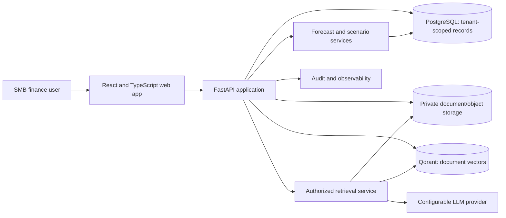
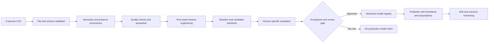
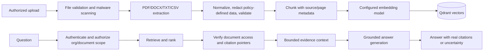

# System Architecture

**Status:** Proposed architecture, not deployed. Initial assumptions: U.S. SMB finance teams, customer-owned CSV files, cash-flow forecasts and scenario simulation.

## Architecture Principles
- Start with a modular monolith; separate logical ownership and interfaces, not infrastructure for its own sake.
- Enforce organization scoping at every service and persistence boundary.
- Separate source records, normalized facts, model outputs, retrieved evidence, generated explanations, and simulated values.
- ML owns numerical predictions; RAG owns evidence retrieval; the LLM explains only provided outputs and passages.
- Keep all financial actions human-directed. No transaction execution or automatic consequential credit/fraud decision.
- Fail closed on authorization and citation provenance; disclose missing data and uncertainty.

## Context Diagram

## Components
- **Web:** React/TypeScript, accessible component library, charting, authenticated API client. Never treat client-side organization IDs as authorization.
- **API:** FastAPI routes, Pydantic request/response contracts, authentication, authorization, rate limits, validation, service orchestration.
- **Domain services:** organizations, imports, financial ledger, forecasts, scenarios, documents, conversations, reporting, audit.
- **PostgreSQL:** canonical structured data and metadata. `organization_id` on tenant-owned data, foreign-key constraints, indexes, transactions; consider row-level security as defense in depth.
- **Document storage:** private object storage for originals; database stores ownership/status/checksum; Qdrant stores embeddings and minimal metadata/pointers. Deletion workflow spans all stores.
- **Qdrant:** vector index partitioned or filtered by organization and document access. Apply authorization before retrieval and validate returned IDs after retrieval.
- **Workers:** asynchronous CSV parsing, extraction, embedding, report generation; jobs carry an authenticated tenant context and idempotency key.
- **ML layer:** pure preprocessing/feature functions, baseline training/backtesting, versioned model artifacts, inference service, monitoring.
- **LLM/embedding adapters:** provider-neutral interfaces, explicit timeouts, content limits, data-processing controls, and safe failure behavior.
- **Redis:** optional job broker/cache after workload requires it; never cache across tenant boundaries without tenant in the key and permission-aware invalidation.

## ML Pipeline

Training and validation splits must be chronological, with an untouched final test interval. Fit transformations only on training data. Store data snapshot identity, feature definition, code version, model version, and metrics.

## RAG Pipeline

Retrieved content is untrusted. It cannot change system instructions, invoke tools, access other tenants, or supply executable commands. Citation IDs/pages are resolved from stored metadata, not generated freely by the LLM.

## ML + RAG Integration Workflow
1. Authenticate user and resolve authorized organization server-side.
2. Retrieve relevant structured financial records within that organization.
3. Run the approved forecast model and persist numerical output, model version, input window, run timestamp, and assumptions.
4. Retrieve relevant authorized documents using organization and document ACL filters.
5. Pass structured prediction fields and bounded retrieved passages as separately typed context to the LLM.
6. Require the response to distinguish model output, sourced statements, assumptions, and unknowns.
7. Validate citations against retrieved IDs; omit unsupported citations and mark evidence gaps.
8. Persist conversation references, model/version IDs, document IDs, and audit metadata with data minimization.

## API Communication
REST/JSON over TLS. OpenAPI is generated from FastAPI contracts and reviewed. Authentication uses short-lived access credentials and secure session/token handling; exact mechanism remains an implementation decision. Request organization scope is resolved from membership, not trusted from payload. Long tasks return job IDs and status endpoints. Apply size limits, idempotency for import/simulation creation, structured errors, and rate limits.

## Database and Storage
PostgreSQL is the source of truth for structured records and access metadata. Qdrant is a derived search index, rebuildable from permitted document sources. Private object storage holds uploaded originals. Every persisted artifact records organization, provenance, creation time, and lifecycle state. Cross-store deletion is tracked as a job and verified; backups follow documented retention controls.

## Deployment Architecture
Local development uses Docker Compose for PostgreSQL, Qdrant, and optional Redis. Application containers and web deployment are staged later. Production should use private networking, managed secrets, encrypted storage, TLS, restricted Qdrant access, backups, restore tests, migration controls, health checks, and monitored workers. No public deployment topology or SLA is approved yet.

## Security Architecture
- Deny-by-default authorization; tenant context is immutable for a request/job.
- Organization membership and role checks in service layer; database constraints/RLS defense in depth.
- Validate uploads by extension, MIME, size, parser limits, and content; malware scan where supported.
- Protect against CSV formula injection on exports and prompt injection in retrieved content.
- Secret manager in production; `.env` only for local development and excluded from version control.
- Minimize raw data in logs, LLM prompts, telemetry, and backups; explicit retention/deletion.
- Audit access and mutations; rate limit public endpoints; dependency and image scanning.
- Human review and visible limitations for consequential outputs.

## Decisions and Open Questions
Proposed: PostgreSQL + Qdrant, FastAPI, React/TypeScript, provider adapters, modular monolith, CSV-first, tenant-aware architecture. Open: identity provider, object store, specific model/embedding/LLM, regional hosting, target latency/availability, encryption/key management, retention, customer CSV schema, and whether RAG is included in MVP.
